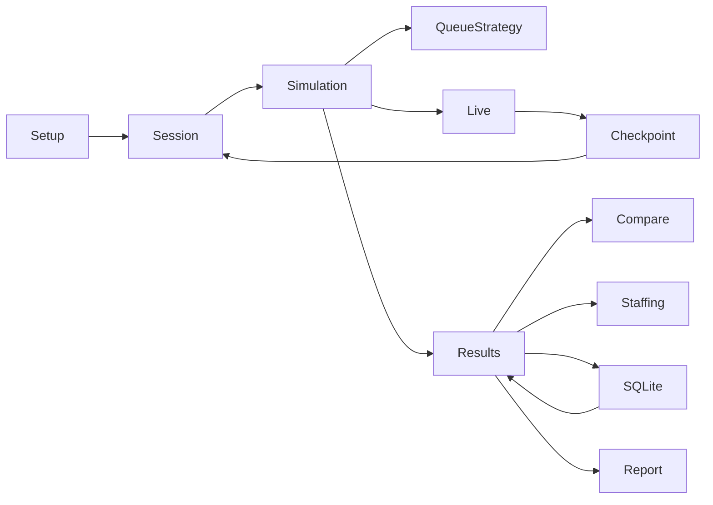
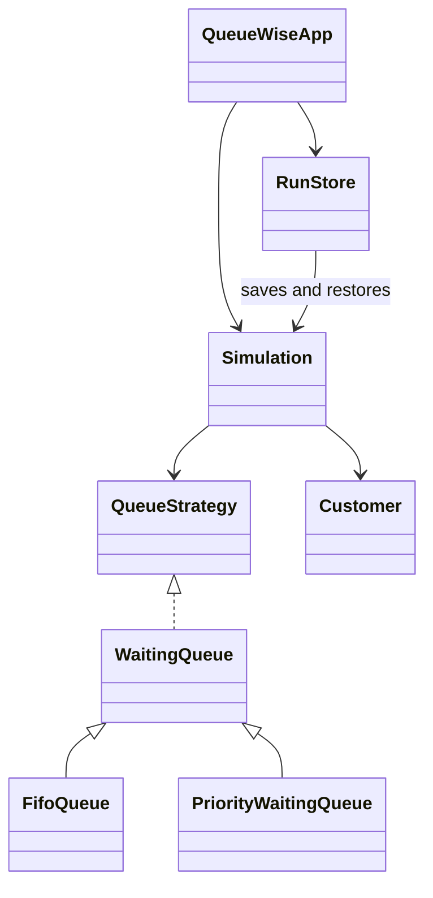

# QueueWise

QueueWise is a desktop simulator for canteens, clinics, and college administration offices. Build an arrival schedule, compare FIFO and Priority using that schedule, and find the smallest number of counters that meets an average waiting-time target.

## Run in IntelliJ IDEA

1. Open this folder as a Maven project.
2. Set the Project SDK and Maven runner JDK to Java 21 or later. The Maven project targets Java 21.
3. In the Maven tool window, run the `javafx:run` goal, or run `mvn javafx:run` in the terminal if Maven is installed.
4. On first launch, open **Setup** or select a preset on **Overview**.

A graphical desktop is required. The application creates the local `data/` folder for its SQLite database, session file, and application log.

## Demo for three presenters

1. **Simulation.** Choose Canteen, one counter, and manual arrivals. Add a five-minute Normal customer at minute 0, a Normal customer at minute 1, and a High customer at minute 2. With one counter, FIFO gives the waiting Normal customer the next slot, while Priority gives it to the High customer. In both cases, the first customer finishes normally.
2. **Persistence.** In Live, pause and save a session. Restart the app, restore it from Overview, and finish the run. In Results, save it to History and export TXT or CSV. Reopen the run from History.
3. **Dashboard.** Compare the strategies, inspect wait times by priority, then open Staffing and change the average wait target. Explain how JavaFX controls and charts present the engine's data.

## Code walkthrough

| Source | What to explain |
| --- | --- |
| `Customer` | A customer stores an ID, arrival minute, service duration, and priority. The constructor validates those values. |
| `QueueStrategy` | One interface defines the waiting-queue operations. The abstract `WaitingQueue` shares those operations across the LinkedList and PriorityQueue implementations. The priority comparator orders by priority, arrival minute, then ID. |
| `Workload` | Presets supply editable defaults. A seeded Random generates reproducible arrivals and service times. Peak hours tighten the gaps in the middle of the workload. |
| `Simulation` | `step()` admits arrivals, assigns free counters, counts the queue and busy counters for one minute, then releases completed service. `runToEnd()` repeats the same step used by the JavaFX live timer. |
| `RunStore` | Prepared JDBC statements implement history create, read, update, and delete. Report writers produce TXT summaries and CSV customer records. Serialization saves the inputs and elapsed minute of a paused run. Restoring replays those minutes to rebuild the exact state. |
| `QueueWiseApp` | `start()` builds the scene and navigation. Each screen displays data from the engine or the store. Button handlers validate actions and show feedback. `stop()` closes the file log. |

## Follow a run through the code

1. **Set up.** `applyPreset()` fills the form. `config()` reads it and creates a session. `Workload.generate()` supplies automatic customers, while the manual form records each customer directly.
2. **Initialize.** The `Simulation` constructor checks for duplicate IDs, sorts arrivals, creates free counter slots, and chooses the queue implementation. On restoration it also replays the recorded minutes.
3. **Advance.** `step()` adds customers arriving at the current minute. It calls `next()` for each free counter, records the start and completion times, samples the waiting queue, and advances the clock. It frees counters whose service ends at the new clock time.
4. **Show.** `advance()` is the JavaFX timer handler. It calls `step()` and `renderLive()` to refresh the queue, counters, and progress bars. The instant button calls `runToEnd()` instead of starting the timer.
5. **Compare.** `summary()` calculates completed-run metrics. `compare()` runs both strategies against the same session, and `waitSeries()` groups results by priority for the bar chart. `staffing()` changes only the tested counter count.
6. **Save.** `snapshot()` captures the original workload, strategy, counter count, and clock. `checkpoint()` writes the snapshot to disk for later `restore()`. `save()` and `open()` handle completed runs in SQLite. `list()`, `rename()`, and `delete()` support History, and `export()` writes the chosen report format.

## Metrics and storage

- **Wait** is service start minus arrival. **Turnaround** is service end minus arrival.
- **Average queue** is the average number waiting during each simulated minute, after available counters take customers. For long runs, the chart plots the peak per time bucket.
- **Utilization** is busy counter-minutes divided by available counter-minutes. Duration starts at simulated minute zero.
- **Staffing** tries 1 through 10 counters with the same workload and strategy. It selects the first count whose unrounded average wait meets the target. A target can be unreachable in that range.
- SQLite table `runs` stores the ID, name, preset, strategy, counter count, average wait, local save time, and serialized workload. Each write is a single atomic SQL statement. History replays the saved workload to regenerate detailed results.
- `session.dat` stores one resumable checkpoint. The checkpoint records the original workload and completed clock ticks. The Java serialization filter limits the accepted classes and input size.

## Syllabus and lab mapping

| Topics | Where they appear |
| --- | --- |
| Unit 1 and introductory labs | Maven structure, encapsulation, strategy interface, abstract class, concrete implementations |
| Unit 2 and Labs 4–7 | Custom validation exception, ArrayList, LinkedList, HashSet, PriorityQueue, Comparator, generics, Math, LocalDateTime, and Optional in dialogs |
| Unit 3 and Labs 8–9 | Buffered text exports, binary checkpoint I/O, serialization and serialVersionUID, logging, properties |
| Unit 4 | SQLite, JDBC statements, ResultSet, CRUD, and a separate data-access class |
| Unit 5 | Stage, Scene, layout containers, JavaFX controls, TableView, charts, event handlers and Timeline |

**Viva questions**

- Why use the same engine for instant and live modes? Their results can be compared directly because both advance the clock through the same code.
- How are priority ties broken? Earlier arrival comes first. If customers arrive together, lower ID comes first.
- How does a checkpoint resume without a serialized queue? The same inputs and elapsed minutes reproduce the same queue, counters, and completed visits.
- Can priority increase waiting for some customers? Yes. A High customer can take the next free slot while a Normal customer who arrived earlier continues waiting.

Frontend references are [Lenis](https://github.com/darkroomengineering/lenis) for native JavaFX scroll easing inspiration and [Higgsfield's frontend design references](https://github.com/higgsfield-ai/skills) for typography, palette, and layout. The glass treatment uses translucent JavaFX CSS panels, fine borders, and restrained shadows.
